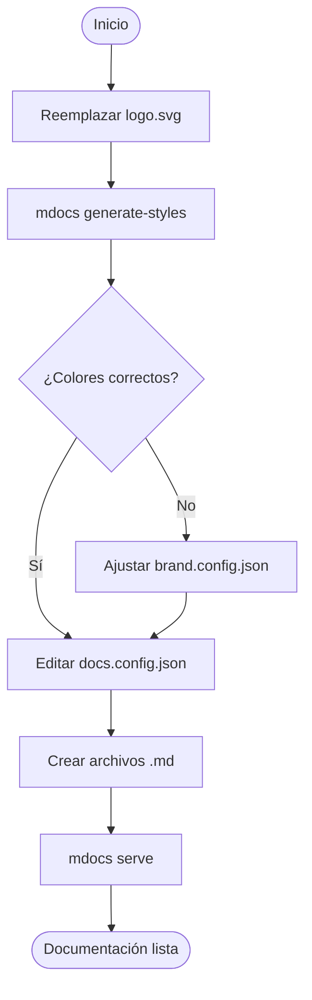
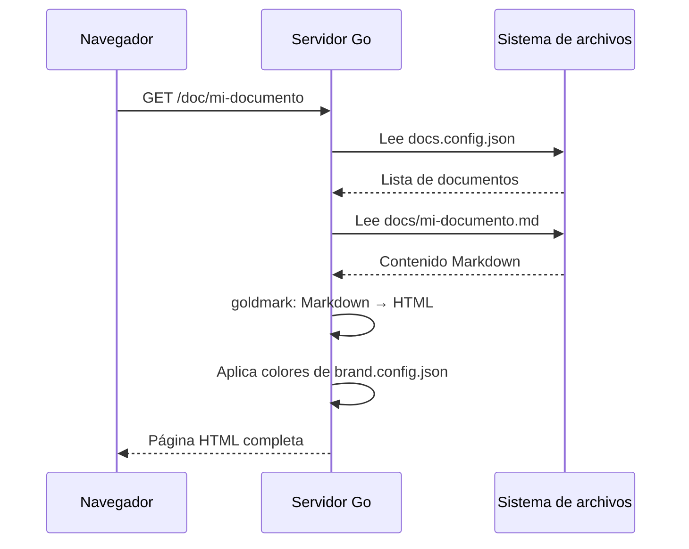

# Referencia técnica

> Reemplaza este archivo con tu documentación técnica, referencia de API o guía avanzada.

Esta sección demuestra todas las funcionalidades de formato soportadas por el visor.

## Diagramas Mermaid

### Diagrama de flujo



### Diagrama de secuencia



## Tablas de referencia

### Campos de brand.config.json

| Campo | Tipo | Descripción | Ejemplo |
|---|---|---|---|
| `primaryColor` | `string` | Color principal (sidebar, cabeceras) | `"#1a2035"` |
| `accentColor` | `string` | Color de acento (links, bordes activos) | `"#0066cc"` |
| `companyName` | `string` | Nombre de la empresa | `"Acme Corp"` |
| `docsTitle` | `string` | Subtítulo bajo el logo | `"Portal de Docs"` |
| `description` | `string` | Descripción en la portada del PDF y metadatos | `"API interna"` |
| `docsYear` | `string` | Año mostrado en el footer | `"2026"` |
| `poweredBy` | `boolean` | Muestra "Powered by" en visor y PDF | `false` |
| `poweredByText` | `string` | Texto de la atribución (default `mdocs`) | `"Acme Labs"` |
| `poweredByUrl` | `string` | Enlace de la atribución | `"https://acme.dev"` |

### Campos de docs.config.json

| Campo | Tipo | Descripción |
|---|---|---|
| `id` | `string` | Identificador único para la URL (`/doc/{id}`) |
| `file` | `string` | Ruta al archivo `.md` relativa a la raíz |
| `title` | `string` | Título mostrado en la barra lateral |
| `subtitle` | `string` | Subtítulo descriptivo en la barra lateral |

### Variables de entorno

| Variable | Valor por defecto | Descripción |
|---|---|---|
| `PORT` | `3000` | Puerto en el que escucha el servidor |
| `MDOCS_CHROME` | detección automática | Ruta a Chrome/Chromium para PDF y draw.io |

## Bloques de código

El visor soporta resaltado de código en múltiples lenguajes:

```go
// Go
type Doc struct {
    ID       string `json:"id"`
    File     string `json:"file"`
    Title    string `json:"title"`
    Subtitle string `json:"subtitle"`
}

func Load(path string) ([]*Doc, error) {
    data, err := os.ReadFile(path)
    if err != nil {
        return nil, err
    }
    var docs []*Doc
    return docs, json.Unmarshal(data, &docs)
}
```

```python
# Python
def generar_reporte(datos: list[dict]) -> str:
    lineas = [f"- {d['titulo']}: {d['valor']}" for d in datos]
    return "\n".join(lineas)
```

```sql
-- SQL
SELECT
    d.id,
    d.titulo,
    COUNT(v.id) AS visitas
FROM documentos d
LEFT JOIN visitas v ON v.doc_id = d.id
GROUP BY d.id, d.titulo
ORDER BY visitas DESC;
```

## Blockquotes

> **Nota:** Los blockquotes son ideales para resaltar advertencias, tips o información importante. Se renderizan con el color de acento definido en `brand.config.json`.

> **Advertencia:** Asegúrate de que `logo.svg` sea un SVG válido con colores en formato hexadecimal (`#rrggbb`) para que el subcomando `generate-styles` funcione correctamente.

---

## Arquitectura del proyecto

```
proyecto/
├── main.go                    ← Entry point (llama a cmd/mdocs.Execute)
├── cmd/mdocs/                 ← CLI: init, serve, build, add, remove, list,
│                                check, context, agents, generate-styles
├── assets/                    ← Embebidos: mermaid.min.js, logo, AGENTS.md
├── templates/                 ← Plantillas embebidas (sobrescribibles)
├── internal/
│   ├── brand/                 ← brand.config.json + colores del logo
│   ├── docs/                  ← Markdown → HTML, anclas, enlaces entre docs
│   ├── project/               ← check y context
│   ├── pdfnav/                ← marcadores, portada y etiquetas del PDF
│   └── server/                ← HTTP, PDF (chromedp) y exportación draw.io
├── docs/*.md                  ← Contenido
├── brand.config.json
├── docs.config.json
└── logo.svg
```
